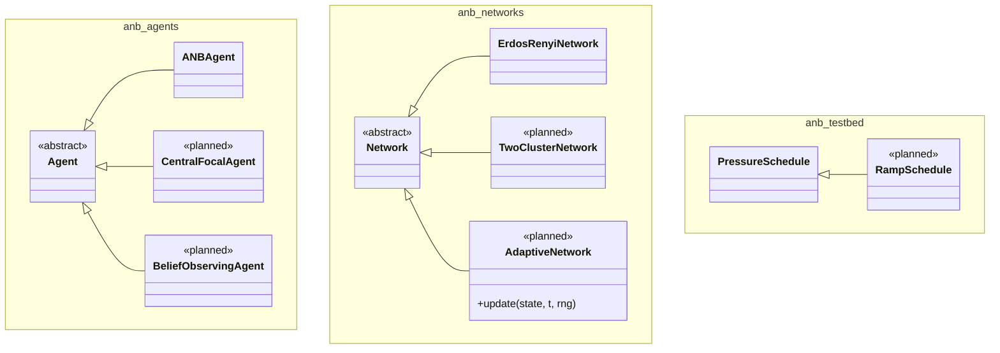
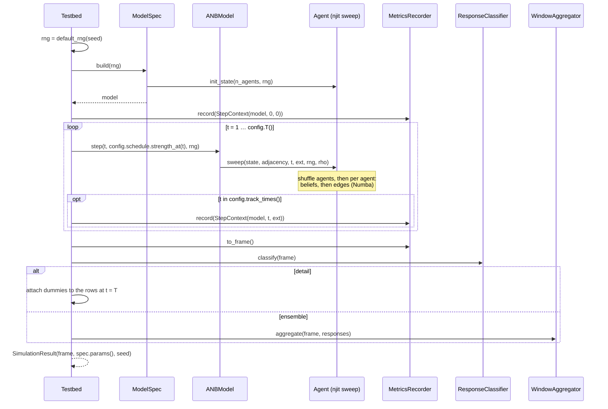

# Class Design: the `anb/` package

Class diagrams for the testbed refactoring decided in
[ADR-002](adr-002-testbed-architecture.md). The diagrams follow the ADR's
[class inventory](adr-002-testbed-architecture.md#resulting-class-inventory), including the amendments Q22–Q25
(one Numba sweep kernel per step, per-agent parameters, analysis windows derived from the schedule), with the
three open points resolved in [Resolved open points](#resolved-open-points). Signatures are indicative. Shapes use `N` agents,
`M` beliefs, `T` time steps and `K = M(M−1)/2` edges.

Each `namespace` block is one module, so `anb_agents` is `anb/agents.py` and so on (Q21). Mermaid does not
allow dots in namespace names, hence the underscores.

Notation: `<<abstract>>` marks an `abc.ABC`, a trailing `*` marks an `@abstractmethod`, a trailing `$` marks
a classmethod, `~T~` is a generic parameter (`list~Metric~` = `list[Metric]`).

## Overview

All classes and how they relate. The 14 concrete metrics and the planned subclasses are left out here and
shown in [Extension points](#extension-points).

```mermaid
classDiagram
    direction LR

    namespace anb_agents {
        class AgentState {
            <<dataclass>>
            +beliefs : ndarray[N, M]
            +edge_weights : ndarray[N, M, M]
            +delta_memory : ndarray[N, tau, M]
            +focal : ndarray~int~[N]
            +n_agents : int
            +n_beliefs : int
            +edge_vector() ndarray[N, K]
            +focal_beliefs() ndarray[N]
        }
        class Agent {
            <<abstract>>
            +n_beliefs : int
            +belief_options : ndarray[21]
            +tau : int
            +learning_until : Optional~int~
            +beta : float or ndarray[N]
            +eps : float or ndarray[N]
            +mu : float or ndarray[N]
            +lam : float or ndarray[N]
            +init_w : float or ndarray[N]
            +fixed : Optional~ndarray~bool~~[N]
            +init_state(n_agents, rng)* AgentState
            +param_arrays(n_agents) dict
            +sweep(state, adjacency, t, ext, rng, rho)*
        }
        class ANBAgent {
            +init_state(n_agents, rng) AgentState
            +sweep(state, adjacency, t, ext, rng, rho)
        }
    }

    namespace anb_networks {
        class Network {
            <<abstract>>
            +adjacency : ndarray[N, N]
            +neighbours(i) ndarray~int~
            +degree() ndarray[N]
            +build(n_agents, rng, **kwargs)$* Network
        }
        class ErdosRenyiNetwork {
            +link_prob : float
            +build(n_agents, rng, link_prob)$ ErdosRenyiNetwork
        }
    }

    namespace anb_model {
        class ModelSpec {
            <<dataclass>>
            +agent : Agent
            +network_cls : type~Network~
            +network_kwargs : dict
            +n_agents : int
            +rho : float
            +build(rng) ANBModel
            +params() dict
        }
        class ANBModel {
            +agent : Agent
            +network : Network
            +state : AgentState
            +rho : float
            +step(t, ext, rng)
        }
    }

    namespace anb_metrics {
        class StepContext {
            <<dataclass>>
            +model : ANBModel
            +t : int
            +ext : float
        }
        class Metric {
            <<abstract>>
            +name : str
            +compute(ctx)* ndarray[N]
        }
        class MetricsRecorder {
            +metrics : list~Metric~
            +record(ctx)
            +to_frame() DataFrame
        }
        class ResponseClassifier {
            +before : range
            +during : range
            +after : range
            +classify(frame) DataFrame
        }
    }

    namespace anb_testbed {
        class PressureSchedule {
            +strength : float
            +events : list~tuple~
            +n_events : int
            +strength_at(t) float
            +single_event(s)$ PressureSchedule
            +two_events(s)$ PressureSchedule
        }
        class TestbedConfig {
            <<dataclass>>
            +schedule : PressureSchedule
            +window_len : int = 10
            +recovery : int = 50
            +detail : bool
            +T() int
            +windows() dict
            +snapshot_times() list~int~
            +track_times() list~int~
        }
        class WindowAggregator {
            +windows : dict
            +snapshot_times : list~int~
            +aggregate(frame, responses) DataFrame
        }
        class Testbed {
            +spec : ModelSpec
            +config : TestbedConfig
            +metrics : list~Metric~
            +classifier : ResponseClassifier
            +aggregator : WindowAggregator
            +run(seed) SimulationResult
            +run_ensemble(seeds, n_jobs) list~SimulationResult~
        }
        class SimulationResult {
            +frame : DataFrame
            +params : dict
            +seed : int
            +to_frame() DataFrame
            +save(directory, legacy_names)
        }
    }

    namespace anb_io {
        class io {
            <<module>>
            +legacy_filename(params, detail)$ str
        }
    }

    Agent <|-- ANBAgent
    Network <|-- ErdosRenyiNetwork

    Agent ..> AgentState : creates and sweeps
    Agent ..> Network : reads adjacency
    ModelSpec o-- Agent : agent
    ModelSpec ..> Network : network_cls.build()
    ModelSpec ..> ANBModel : builds
    ANBModel o-- Agent
    ANBModel *-- Network
    ANBModel *-- AgentState

    StepContext --> ANBModel
    Metric ..> StepContext : reads
    MetricsRecorder o-- "1..*" Metric

    Testbed o-- ModelSpec
    Testbed o-- TestbedConfig
    TestbedConfig o-- PressureSchedule
    Testbed o-- ResponseClassifier
    Testbed o-- WindowAggregator
    Testbed ..> MetricsRecorder : one per run
    Testbed ..> StepContext : creates per tracked t
    Testbed ..> SimulationResult : returns
    TestbedConfig ..> ResponseClassifier : windows
    TestbedConfig ..> WindowAggregator : windows
    SimulationResult ..> io : save(legacy_names=True)
```

## Extension points

Every abstract class and the schedule, with the concrete classes of the first version (solid) and the planned
ones from [projectIdea.md](../projectIdea.md) (`<<planned>>`). The metric column name is in brackets.

`Agent` subclasses are new update rules only: `CentralFocalAgent` picks the focal belief (idea 3) and
`BeliefObservingAgent` adapts edges from observed beliefs (idea 1). Influencers (idea 2) and heterogeneous β
(idea 4) are parameter settings of `ANBAgent`: a `fixed` mask and an `(N,)` array for `beta` (ADR-002 Q23).

```mermaid
classDiagram
    direction LR

    namespace anb_metrics {
        class Metric {
            <<abstract>>
            +name : str
            +compute(ctx)* ndarray[N]
        }
        class Degree["Degree (n_nbs)"]
        class PersonalEnergy["PersonalEnergy (Hpers)"]
        class FocalPersonalEnergy["FocalPersonalEnergy (Hpersfoc)"]
        class SocialEnergy["SocialEnergy (Hsoc)"] {
            +aggregate : str = "mean"
        }
        class ExternalEnergy["ExternalEnergy (Hext)"]
        class TriangleBalance["TriangleBalance (tb_tot)"]
        class FocalTriangleBalance["FocalTriangleBalance (tb_foc)"]
        class MeanAbsEdge["MeanAbsEdge (absOm_tot)"]
        class FocalMeanAbsEdge["FocalMeanAbsEdge (absOm_foc)"]
        class WeightedClustering["WeightedClustering (clust)"]
        class FocalBetweenness["FocalBetweenness (bc_foc)"]
        class ExpectedInfluence["ExpectedInfluence (expI)"]
        class FocalBelief["FocalBelief (x_focal)"]
        class NonFocalExtremity["NonFocalExtremity (extr_nonfoc)"]
    }

    Metric <|-- Degree
    Metric <|-- PersonalEnergy
    Metric <|-- FocalPersonalEnergy
    Metric <|-- SocialEnergy
    Metric <|-- ExternalEnergy
    Metric <|-- TriangleBalance
    Metric <|-- FocalTriangleBalance
    Metric <|-- MeanAbsEdge
    Metric <|-- FocalMeanAbsEdge
    Metric <|-- WeightedClustering
    Metric <|-- FocalBetweenness
    Metric <|-- ExpectedInfluence
    Metric <|-- FocalBelief
    Metric <|-- NonFocalExtremity
```

Related metrics share private module-level helpers, for example the two balance metrics share one triangle
pass. The helpers are not part of the class hierarchy.

## Responsibilities

### `anb/agents.py`

| Class | Responsibility |
|-------|----------------|
| `AgentState` | Holds the population's data as plain arrays: beliefs, symmetric edge matrices, the last τ belief changes and the focal dimension per agent (Q8, Q14, Q18). Has no behaviour beyond read-only views (`edge_vector()` in legacy `w{m}{n}` order, `focal_beliefs()`). `n_agents` and `n_beliefs` are properties read from the array shapes, so it does not store `M` or `N` separately |
| `Agent` | An agent type: the update rule and its parameters (Q4, Q9). Owns `M` and the 21-point belief grid, and creates a matching `AgentState` in `init_state`. `beta`, `eps`, `mu`, `lam` and `init_w` are scalars or `(N,)` arrays, and `fixed` marks agents that never update (Q23). `param_arrays` broadcasts them to `(N,)` for the kernel. `sweep` runs one whole random-sequential step (Q22) |
| `ANBAgent` | The paper's agent: Glauber belief updates (eq. 2) and Hebbian + social + decay edge updates (eq. 3), as one `@njit` sweep kernel (ADR-001). Per agent in shuffled order: social input ρ · Σ x_foc over the neighbours from `adjacency`, belief resampling in random order with `delta_memory`, then the edge update with the neighbours' mean edge matrix, Σ_k A_ik W_k / Σ_k |A_ik| (μ = 0 without neighbours). Skips fixed agents, and skips the edge update once `t ≥ learning_until` (Q19) |

### `anb/networks.py`

| Class | Responsibility |
|-------|----------------|
| `Network` | The static social network as an adjacency matrix (Q6). Provides `neighbours(i)` and `degree()` from the adjacency, so subclasses only implement `build` |
| `ErdosRenyiNetwork` | Draws a G(N, p) graph from the injected `rng`. Reproduces the legacy topology statistically, not edge for edge (Q7) |

### `anb/model.py`

| Class | Responsibility |
|-------|----------------|
| `ModelSpec` | The injectable, picklable factory (Q16). `build(rng)` calls `agent.init_state` and `network_cls.build` with the same `rng` and checks that both, and every per-agent parameter, use `n_agents`. `params()` returns the parameters that become output columns and feed `legacy_filename`: scalars for uniform parameters, `(N,)` arrays for per-agent ones. `fixedBNat100` is true only for `learning_until = 101`; any other gate adds a `learning_until` column and a `fixed` mask a per-agent `fixed` column, and neither has a legacy filename |
| `ANBModel` | `step(t, ext, rng)` hands one sweep to `agent.sweep(state, network.adjacency, t, ext, rng, rho)` (Q22). The one place where an adaptive network's update would go (Q6). Knows nothing about time windows, pressure protocols or metrics (Q5) |

### `anb/metrics.py`

| Class | Responsibility |
|-------|----------------|
| `StepContext` | Everything a metric may read at time `t`: the model (state, network, ρ), `t` and the current pressure (Q20). New fields can be added without breaking existing metrics |
| `Metric` | One output column. `compute(ctx)` returns one value per agent (Q10) |
| 14 concrete metrics | One per legacy column, see [Extension points](#extension-points). `SocialEnergy` defaults to the neighbour mean to match legacy, see below |
| `MetricsRecorder` | Calls every metric at each tracked `t` and stores a snapshot together with the beliefs and `edge_vector()`. `to_frame()` returns the long frame (`t`, `id`, metric columns, `0`…`9`, `w01`…`w89`). One recorder per run, so runs share no state |
| `ResponseClassifier` | Post-hoc classification from the focal-belief means over the before, during and after windows. Returns one row per agent with the six dummies (`persistPos` … `latecompliant`), using the legacy rules unchanged, including their zero handling (see [known-issues.md](known-issues.md)) |

### `anb/testbed.py`

| Class | Responsibility |
|-------|----------------|
| `PressureSchedule` | Maps `t` to the external pressure (Q11). `events` holds the inclusive pressure intervals and is the only place pressure timing is defined (Q24). `single_event(s)` covers t = 101–150, `two_events(s)` adds 201–250 and replaces the `two_external_events` flag. Ramps and pulses are subclasses |
| `TestbedConfig` | The experiment protocol: the schedule, `window_len = 10`, `recovery = 50` and `detail`. Derives everything else from the schedule's events (Q24): `T()` = last event end + `recovery`; `windows()` = `before` (the 10 steps before the first event), plus `during`/`after` per event (the last 10 steps of the event and of the recovery after it), giving legacy's 91–100, 141–150, 191–200 (and 241–250, 291–300); `snapshot_times()` = 0, 100, 200 (and 300); `track_times()` = every `t` if `detail`, otherwise {0, 1} ∪ windows ∪ snapshots. The classifier and the aggregator both take `windows()` |
| `WindowAggregator` | Turns the long frame into the ensemble-mode output: the snapshot rows plus one mean row per window, labelled with the window midpoint (95.5, 145.5, 195.5, plus 245.5 and 295.5 for two events), with the response dummies on the before row |
| `Testbed` | Owns the experiment: creates `default_rng(seed)`, builds the model from the spec, steps it through `config.schedule`, records at `config.track_times()`, then classifies and aggregates (Q5, Q17). `run_ensemble` runs seeds in parallel with `joblib` |
| `SimulationResult` | A plain container for one run: the finished frame, the parameters (spec and schedule) and the seed. `to_frame()` appends the parameter columns, joining per-agent ones on `id`. `save()` writes the CSV, by default under the legacy filename (Q12, Q15) |

### `anb/io.py`

| Function | Responsibility |
|----------|----------------|
| `legacy_filename(params, detail)` | Reproduces `run_one`'s filename exactly, so the `analyse_*.py` scripts find new runs (Q15). Reads `lam` and `n_events` from `params`. Shown as a `<<module>>` box in the diagram because it is a function, not a class |

## Sequence of one run

Not a class diagram, but it shows how the classes above work together in `Testbed.run(seed)`.

## Resolved open points

The three open points from [ADR-002](adr-002-testbed-architecture.md#open-points-not-covered-in-the-interview-resolve-while-writing-the-diagram):

1. **Window aggregation owner → its own `WindowAggregator` in `anb/testbed.py`.** The averaging and the
   ensemble row selection are protocol logic: they depend on `TestbedConfig`'s windows and snapshot times, and
   they change when the protocol changes (two events, ramps). Putting them in `SimulationResult.to_frame()`
   would make the result object depend on the config. As a separate class it can be tested on a hand-made
   long frame, and `SimulationResult` stays a plain container. `ResponseClassifier` and `WindowAggregator`
   both take their windows from `TestbedConfig.windows()`.
2. **`Hsoc` mean vs. sum → `SocialEnergy(aggregate="mean")` by default.** The default reproduces legacy so
   new runs stay comparable with the paper's results. `aggregate="sum"` gives the value consistent with
   eq. 1 and the dynamics in `ANBModel.step`. The mismatch is [known issue #1](known-issues.md); the
   dynamics always use the sum.
3. **`M` and the belief grid → on `Agent`.** `Agent.n_beliefs` and `Agent.belief_options` define them, and
   `Agent.init_state` allocates `AgentState` with that shape. `AgentState.n_beliefs` and `n_agents` are read
   from the array shapes, so there is one source of truth. `ModelSpec` passes `n_agents` to both
   `init_state` and `Network.build` and checks that the sizes match, including the per-agent parameters (Q23).
