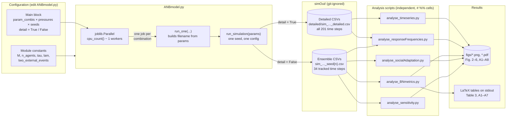

# System Overview

How the pieces of the repository fit together: a parameter sweep in `ANBmodel.py` writes one CSV per
simulation, and five independent analysis scripts read those CSVs and produce the paper's figures and
tables. For details, see [running-simulations.md](running-simulations.md), [model.md](model.md) and
[analysis.md](analysis.md).

## Pipeline

The analysis scripts don't import anything from `ANBmodel.py`. They find their input files by exact
filename, so the filename that `run_one` builds is the only link between the two halves. If a parameter
appears in the filename with a different format, or a run is missing, the analysis script fails when it
calls `pd.read_csv`. For the runs each script expects, see
[running-simulations.md](running-simulations.md#runs-needed-for-each-analysis-script).

## Inside one simulation

```mermaid
flowchart TD
    I["initialise_agents(init_w)<br/>M = 10 beliefs + 45 edge weights per agent"]
    N["initialise_network(seed, link_prob)<br/>random social network → nb_list"]
    M0["fill_metrics(t = 0)"]
    I --> N --> M0 --> LOOP

    subgraph LOOP["for t = 1 … T (200)"]
        direction TB
        X{"t in ext_time<br/>(101–150)?"}
        X -->|yes| XS["external pressure s_t = s<br/>(eq. 4)"]
        X -->|no| X0["external pressure s_t = 0"]
        XS --> SH
        X0 --> SH
        SH["shuffle agent order"]

        subgraph AG["for each agent n"]
            direction TB
            SOC["read social input from agents array<br/>S = Σ_k x_foc⁽ᵏ⁾ over neighbours k"]
            subgraph UB["update_belief: for each belief d (shuffled order)"]
                direction TB
                DD["ΔD(x') = −(x' − x_d) · [ Σ_j≠d ω_dj x_j<br/>+ 1(d = foc) · (s_t + ρ S) ]<br/>(from eq. 1)"]
                GL["glauber_fast: p(x') ∝ 1 / (1 + e^(β ΔD(x')))<br/>over 21 candidates x' (eq. 2)"]
                WB["sample x_d ~ p, write back immediately"]
                DD --> GL --> WB
            end
            MEM["shift τ-step memory, store Δx = x(t) − x(t−1)"]
            W{"module-level fixedBNat100<br/>and t ≥ 101?"}
            subgraph UE["update_edge_weights: all 45 edges at once (eq. 3)"]
                direction TB
                CF["ε, μ ← 0 if params fixedBNat100 and t > 101<br/>μ ← 0 if agent has no neighbours"]
                MS["read ω̄⁽ᴷ⁾ = mean edge vector of neighbours"]
                HB["∂x_m = (1/τ) Σ_i Δx_m(t−i)"]
                EQ3["ω_mn ← ω_mn + ε ∂x_m ∂x_n<br/>+ μ (ω̄_mn⁽ᴷ⁾ − ω_mn) − λ ω_mn"]
                CF --> MS --> HB --> EQ3
            end
            NA["next agent"]
            SOC --> UB --> MEM --> W
            W -->|no| UE --> NA
            W -->|"yes: edge update skipped"| NA
        end

        SH --> AG
        AG --> TR{"t in track_times?"}
        TR -->|yes| FM["fill_metrics(t)<br/>append snapshot"]
        TR -->|no| NT["next t"]
        FM --> NT
    end

    LOOP --> GO["get_output(snapshots)<br/>metrics, before/during/after averages,<br/>response classification"]
    GO --> CSV[("CSV in simOut/")]
```

### Formulas used in one agent update

| Diagram step | Function | Formula | Paper |
|---|---|---|---|
| External pressure | `run_simulation` | $s_t = s$ if $t \in$ `ext_time`, else $0$ | eq. 4 |
| Social input | `run_simulation` | $S = \sum_{k\in\mathcal K} x^{(k)}_{foc}$ (sum, read asynchronously) | eq. 1 |
| Dissonance change | `glauber_fast` | $\Delta D(x') = -(x'-x_d)\big[\sum_{j\neq d}\omega_{dj}x_j + \mathbb 1_{d=foc}(s_t + \rho S)\big]$ | from eq. 1 |
| Glauber step | `glauber_fast` | $p(x') \propto \dfrac{1}{1+e^{\beta\,\Delta D(x')}}$ over the 21 options | eq. 2 |
| Belief-change memory | `update_belief` | $\Delta x = x(t) - x(t-1)$, last $\tau$ steps kept | – |
| Hebbian signal | `update_edge_weights` | $\partial x_m = \tfrac1\tau\sum_{i=0}^{\tau-1}\Delta x_m(t-i)$ | eq. 3 |
| Edge update | `update_edge_weights` | $\omega_{mn} \leftarrow \omega_{mn} + \epsilon\,\partial x_m\partial x_n + \mu(\bar\omega^{(\mathcal K)}_{mn} - \omega_{mn}) - \lambda\omega_{mn}$ | eq. 3 ($\lambda$ term not in paper) |

There are two `fixedBNat100` gates (see [model.md §11](model.md#11-implementation-notes-and-caveats)). The module-level flag skips the edge
update entirely from $t = 101$. The per-run parameter only sets $\epsilon = \mu = 0$ for $t > 101$, so the
$\lambda$ decay still applies.

In ensemble mode, `track_times` holds only t = 0, 1, 91–100, 141–150, 191–200 and 200. In detailed mode it
holds every step. `get_output` adds the averaged rows `t = 95.5` (before), `145.5` (during) and `195.5`
(after). Only the `95.5` row carries the response dummies (compliant, resilient, resistant, …) that the
analysis scripts count. See [model.md](model.md) for the update equations and the response definitions.
